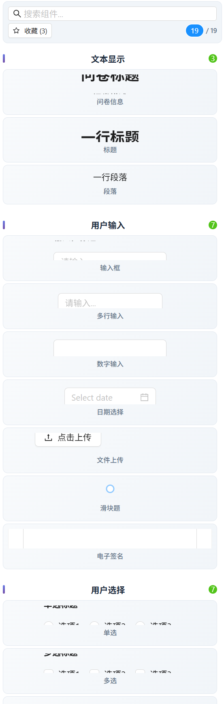

**English** | [简体中文](./readme-zh-cn.md)

<p align="center">
  
</p>

<div align="center">

# Questionnaire Star · Editor

<p>
  <strong>A visual workspace for building questionnaires</strong><br />
  Build questionnaires from reusable components in a visual editing workspace.<br />
  <sub>Compose questions · Arrange the canvas · Review response statistics</sub>
</p>

<p>
  <a href="#quick-start"></a>
  <a href="https://github.com/guolola/questionnaire-star---react/issues"></a>
  <a href="./LICENSE"></a>
</p>

<p>
  
  
  
  
</p>

> Compose questions, refine the flow, understand the responses. Keep question components, canvas settings and analysis views together in one visual workspace.

</div>

## Overview

A React and TypeScript questionnaire editor with an Ant Design interface. Build forms from a component library, adjust properties on the canvas, manage questionnaires and explore response statistics.

This repository contains the **editor frontend**. Authentication, persistence and statistics depend on a separate API service; the backend is not included. The companion [respondent prototype](https://github.com/guolola/qustion-star-c) is maintained separately and is not yet connected end to end.

[Choose a workflow](#choose-a-workflow) · [Explore capabilities](#core-capabilities) · [Run locally](#quick-start) · [Explore the architecture](#architecture)

## Choose a Workflow

| Start here | How to work | What it depends on |
| --- | --- | --- |
| Build a questionnaire | Add components, sort the canvas, edit properties and page settings | Editor state; API needed for loading and saving |
| Draft with AI | Describe the survey in the AI panel and review the generated question configuration | A configured AI service; the bundled key is empty |
| Review responses | Open the statistics route and inspect question-level charts | Backend integration; current summary cards use sample data |

1. Create or open a questionnaire from the management views.
2. Compose questions in the component library and arrange their order on the canvas.
3. Adjust component properties, page settings and any applicable validation rules.
4. Save through the backend adapter, then implement or connect publishing and collection services.

The [respondent repository](https://github.com/guolola/qustion-star-c) is a separate early prototype. The two repositories do not yet provide a connected publishing-to-submission workflow.

## Interface Preview

The source includes a component-library capture. It shows the existing library UI, rather than an independently verified deployment or a complete questionnaire editor screen.

<details>
<summary>View the component-library capture</summary>

<p align="center"></p>

</details>

## Core Capabilities

| Area | Included in the source |
| --- | --- |
| Question library | 19 registered components, including text, choices, dates, numbers, ratings, matrices and file uploads |
| Visual editing | Drag sorting, property and page settings, layers and undo/redo state |
| Management | List, search, star, duplicate and trash views with API service adapters |
| Statistics | Response views and chart components using Recharts |
| AI assistance | DeepSeek questionnaire generation and streaming client code; integration requires configuration |
| Advanced tools | Conditional logic, validation, multi-page and branching editors and utility modules |

Advanced controls are implementation entry points, not a guarantee of complete backend behavior. Payment, file upload and signature components require application-specific services before real use.

### Current Scope

| Capability | Frontend source | Additional work |
| --- | :---: | --- |
| Question components and property editors | Included | Verify each component against the intended question schema |
| Drag sorting, copy/paste, hide and lock | Included | Exercise the editing workflow with real questionnaire data |
| Authentication and questionnaire persistence | API adapters | Supply and configure a compatible backend |
| Response statistics | UI and chart components | Replace sample summary figures and connect actual answers |
| File upload, payment and signature | UI components | Connect the relevant storage or business services |
| Published questionnaire collection | Separate prototype | Define and integrate the publishing and submission contracts |

## Quick Start

### 1. Install and start

Use Node.js 22.12+ and npm. From a terminal:

```bash
git clone https://github.com/guolola/questionnaire-star---react.git
cd questionnaire-star---react
npm install
npm run dev
```

Open the local URL printed by Vite (normally `http://localhost:5173`).

### 2. Connect a backend

The development proxy in `vite.config.ts` forwards `/api` to `http://localhost:3001`. Run a compatible backend there or change the proxy target. Service adapters under `src/services` define user, questionnaire and statistics endpoints and expect a response envelope shaped like `{ errno: 0, data: ... }`.

The small mock file in `src/_mock` is not a complete backend and is not loaded by the app entry point. Without a backend, authenticated management flows cannot work fully. For deployment, configure `/api` routing and SPA fallback in your hosting service; Vite's development proxy is not used in the production build.

### 3. Configure AI assistance

The migrated source has no bundled API key. The DeepSeek client in `src/services/deepseekApi.ts` currently has an empty default key. For a shared deployment, keep provider credentials on your server and route AI requests through an authenticated backend. Do not put a real key in frontend code or a `VITE_*` variable: browser bundles expose those values.

## Architecture

| Directory | Responsibility |
| --- | --- |
| `src/components/QuestionComponents` | Question renderers, property editors and statistics components |
| `src/pages/question/Edit` | Canvas, toolbar, side panels and AI chat |
| `src/pages/question/Stat` | Questionnaire response analysis |
| `src/pages/manage` | Lists, starred questionnaires and trash |
| `src/store` | Redux state, page settings and edit history |
| `src/services` | Backend and AI client adapters |
| `src/utils` | Validation, branching and other advanced helpers |

## Common Commands

| Command | Purpose |
| --- | --- |
| `npm run dev` | Start the Vite development server |
| `npm run build` | Type-check and build the frontend |
| `npm run preview` | Preview the production build locally |
| `npm run lint` | Run ESLint |
| `npm run format:check` | Check source formatting |

## Migration Notes

Imported from [Gitee](https://gitee.com/guolola/questionnaire-star---react). Historical commits were sanitized to remove a hardcoded provider credential, so affected commit hashes differ from the source repository. Author and timestamp metadata were retained. Exposed credentials must still be revoked at the provider.

## Documentation

- [Question component registry](./src/components/QuestionComponents/index.ts)
- [Application routes](./src/router/index.tsx)
- [Development proxy](./vite.config.ts)
- [Questionnaire API adapter](./src/services/question.ts)
- [Respondent prototype](https://github.com/guolola/qustion-star-c)

## License

[MIT](./LICENSE) · Copyright © 2026 guolola.
